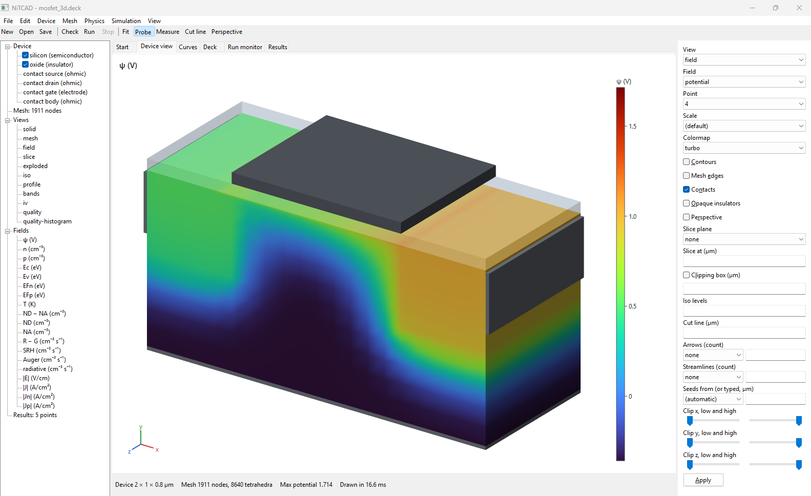
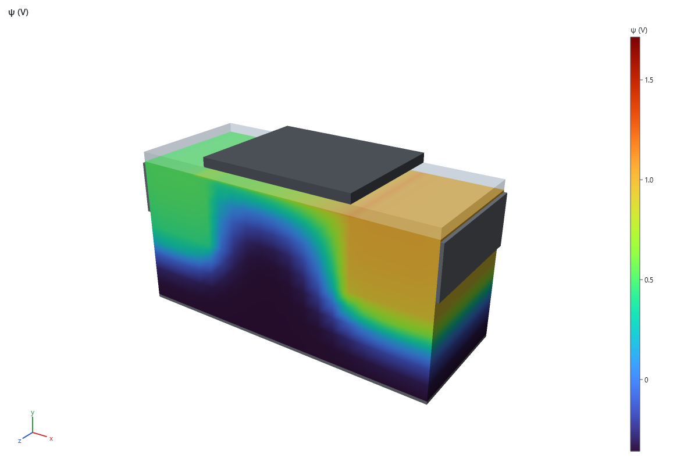
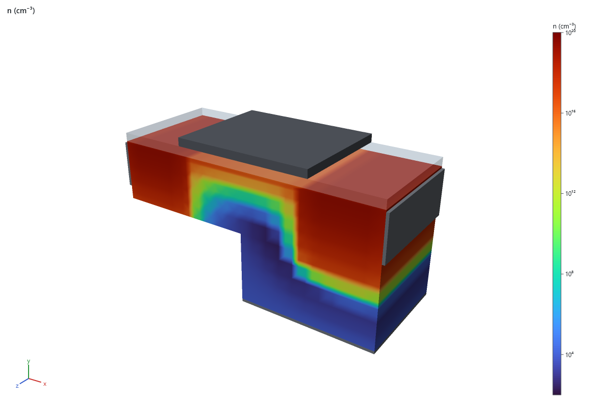
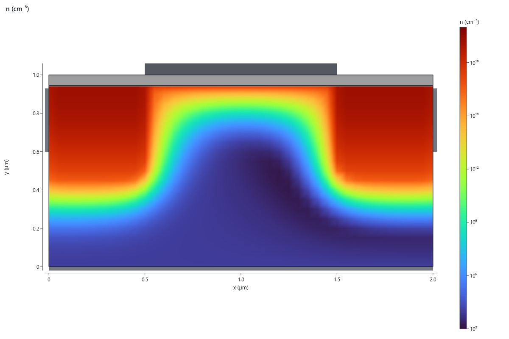
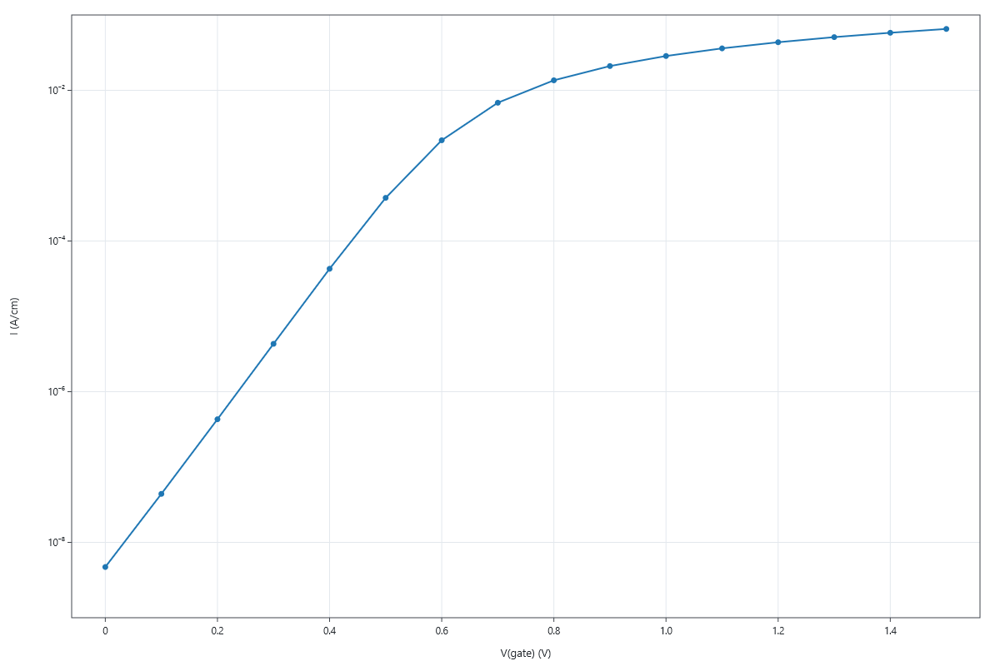
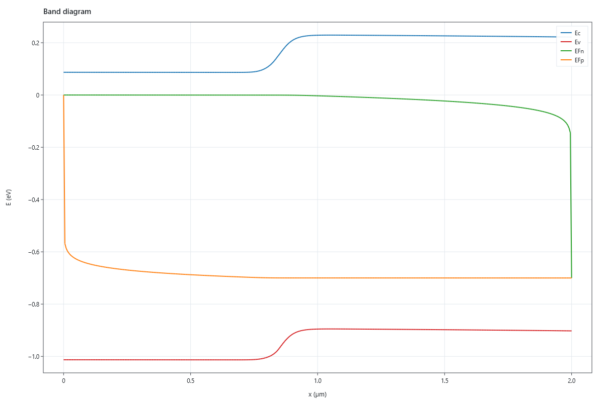
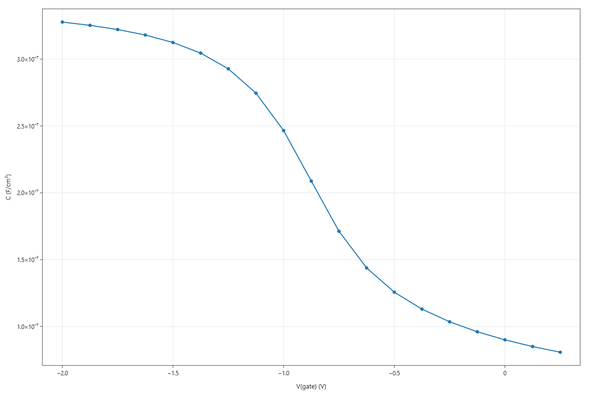

# NiTCAD

NiTCAD is a semiconductor device simulator (TCAD) for Windows, written in C++23. It solves the drift-diffusion
equations by the box method on 1D, 2D and 3D meshes, from tensor grids to unstructured Delaunay meshes. Devices are
described in a plain-text input deck and run from the command line or from a native Windows application.

Every model is validated before it lands: analytic and limiting cases, published values, finite-difference Jacobian
checks, dimensional-reduction identities, convergence studies and hand mutation tests. The design and the evidence
for each unit are in [`ARCHITECTURE.md`](ARCHITECTURE.md) and [`DECISIONS.md`](DECISIONS.md).



## Gallery

Rendered with `nitcad plot` from the decks in `examples/`.

**3D**: an n-channel MOSFET (`examples/mosfet_3d.deck`, 1,911 nodes) at V<sub>G</sub> = 1.2 V, V<sub>D</sub> = 0.5 V.

| Electrostatic potential | Electron density, a quarter clipped away |
|---|---|
|  |  |

**2D**: an n-channel MOSFET in cross-section (`examples/mosfet_2d.deck`): 50 nm oxide, V<sub>D</sub> = 0.1 V.

| Electron density at V<sub>G</sub> = 1.5 V | Transfer curve I<sub>D</sub>–V<sub>G</sub> |
|---|---|
|  |  |

**1D**: a pn diode (`examples/pn_diode_1d.deck`) and a MOS capacitor (`examples/moscap_cv.deck`).

| pn diode band diagram at 0.7 V forward | MOS capacitor C–V at 1 MHz |
|---|---|
|  |  |

## Capabilities

**Physics**
- Poisson and electron/hole continuity (Scharfetter–Gummel fluxes), Boltzmann or Fermi–Dirac statistics
- Recombination: SRH, Auger; band-gap narrowing; impact ionization; band-to-band tunnelling (local and nonlocal)
- Mobility: doping-dependent (Masetti, the silicon default), lateral-field (Canali), surface-roughness (Lombardi, opt-in)
- Heterojunctions with thermionic emission; insulators with interface traps; dopant ionization (opt-in)
- Contacts: ohmic, Schottky (thermionic emission for both carriers), gates, thermal contacts
- Electrothermal coupling (lattice heat equation)
- Published silicon defaults (Couderc band set, Masetti mobilities)

**Analyses**
- Equilibrium and DC bias sweeps, with bias step cutting, a Newton line search and arc-length continuation
- Transient and AC small-signal analysis
- Extraction: threshold voltage, subthreshold swing, transconductance, C–V, two-port parameters
- Accurate low currents (weighted terminal current with an error estimate)

**Numerics and meshes**
- Linear solvers: Eigen sparse LU (default), Intel PARDISO (opt-in, loaded at run time), GMRES with ILUT
- Tensor grids in 1D, 2D and 3D; 2D and 3D Delaunay generators with conforming material interfaces, contact
  patches and structured 2D boundary layers
- Deterministic, reproducible results; every run carries an identity digest and its provenance

**Input, output and visualization**
- Text input deck, versioned and checksummed device, sweep and checkpoint files, checkpoint/restart, CSV tables
- `nitcad plot` renders fields, band diagrams, curves, isosurfaces, streamlines and vector fields to PNG
- `nitcad-app`: a Win32 + Direct3D 12 + Direct2D application to edit decks, run them and inspect results

Not yet available (planned, see `ARCHITECTURE.md` 11.3): quantum confinement (MLDA is in review), gate tunnelling,
hydrodynamic/energy-balance transport, 3D structured boundary layers.

## Requirements

- Windows 10/11, x64
- Visual Studio 2026 (MSVC toolset 14.51) or the matching Build Tools, with the Windows SDK 10.0.26100.0
- CMake 4.3 or later and Ninja
- [vcpkg](https://github.com/microsoft/vcpkg), checked out at the manifest's `builtin-baseline`
  (`fbb0f7bb200b07a9eb9081c7a3cf51d1aa1c51a1`); the build refuses any other commit. It provides Eigen 5.0.1 and
  Catch2 3.16.0.
- Optional: the Intel MKL runtime (`mkl_rt.3.dll`, e.g. from Intel's `intelmkl.redist.win-x64` NuGet package) for
  the PARDISO solver. Nothing links against MKL; it is loaded at run time when a deck asks for it.

## Building

From a Visual Studio x64 developer prompt:

```bat
git clone https://github.com/microsoft/vcpkg.git C:\vcpkg
git -C C:\vcpkg checkout fbb0f7bb200b07a9eb9081c7a3cf51d1aa1c51a1
C:\vcpkg\bootstrap-vcpkg.bat -disableMetrics

rem The developer prompt sets VCPKG_ROOT to Visual Studio's own vcpkg; point it at the pinned checkout.
set VCPKG_ROOT=C:\vcpkg

cmake --preset release
cmake --build --preset release
ctest --preset release
```

The `debug` preset works the same way. Builds go to `build/<preset>`. Warnings are errors (`/W4 /WX`).

To run the PARDISO tests too, configure with `-DNITCAD_MKL_RUNTIME=<path to mkl_rt.3.dll>`; without it they are
skipped.

## Usage

```text
nitcad check <deck>                                        validate a deck without solving
nitcad run <deck>                                          solve it and write its outputs
nitcad plot <deck or result file> [options] --out <image.png>
nitcad --version
```

A deck is a set of sections. The 1D pn diode from `examples/`:

```ini
[mesh]
type = tensor
x = linspace(0, 2um, 401)

[region silicon]
material = silicon

[doping]
profile = donor erfc 1e18 axis=x center=0.8um width=0.05um
profile = acceptor constant 1e16

[contact cathode]
kind = ohmic
patch = x_min

[contact anode]
kind = ohmic
patch = x_max

[sweep]
contact anode = 0 : 0.7 : 0.05

[output]
sweep = pn_diode_1d.nitsweep
device = pn_diode_1d.nitdev
table = pn_diode_1d.csv
```

```bat
build\release\nitcad.exe run examples\pn_diode_1d.deck
```

More examples:

| Deck | Device |
|---|---|
| `examples/pn_diode_1d.deck` | 1D silicon pn diode, forward I–V |
| `examples/moscap_cv.deck` | MOS capacitor, C–V |
| `examples/mosfet_2d.deck` | 2D n-MOSFET, Id–Vg with threshold and swing |
| `examples/mosfet_3d.deck` | 3D n-MOSFET, gate sweep at 0.5 V drain bias |
| `decks/schottky_diode_1d.deck` | 1D Schottky diode, −1 V to +0.4 V |
| `decks/finfet_3d.deck` | 3D tri-gate SOI FinFET (large; use PARDISO) |
| `benchmarks/resistivity/` | Resistor decks for validation against published resistivity data (NBS SP 400-64) |

The deck language is described in `ARCHITECTURE.md` 6.5 (input) and 6.6 (results). Press Ctrl+C during a run to
stop it; the completed points are still written.

The application, `build\release\nitcad-app.exe`, opens a deck, runs it (F5) and shows its fields, curves and
extracted results.

## Repository layout

| Path | Contents |
|---|---|
| `include/NiTCAD/`, `src/` | The library, by layer: `base`, `linalg`, `mesh`, `physics`, `device`, `assemble`, `solve`, `analysis`, `results`, `io`, `deck`, `render`, `app` |
| `src/cli/` | The `nitcad` command-line runner |
| `app/` | The `nitcad-app` Windows application |
| `tests/` | Catch2 test suites, one per layer |
| `examples/`, `decks/`, `benchmarks/` | Input decks |
| `ARCHITECTURE.md` | The architecture, the physics contract, and the status of every capability |
| `DECISIONS.md` | Per-unit design decisions, acceptance criteria and results |

## Development

Work proceeds in numbered units, each on its own branch. Its design and acceptance criteria are written into
`DECISIONS.md` before any code, and it merges to `main` through a pull request once the Debug and Release suites pass.
CI (`.github/workflows/ci.yml`) builds and tests both presets on Windows with pinned toolchain versions.

## License

MIT; see [`LICENSE`](LICENSE).
